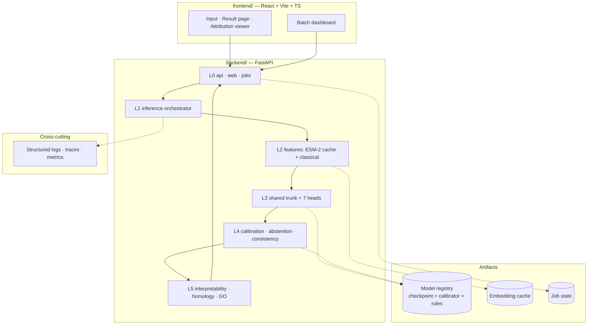

# ProtLoc Fusion — Master Project Plan

> Plan of record, ideation → production. Companion to `CLAUDE.md` (the execution
> contract) and `FOLDER_STRUCTURE.md` (the repository blueprint).
>
> Version 1.0 · 2026-09-09

---

## 1. Overview

- **What:** A unified protein-analysis web server and API that answers seven related
  annotation questions about one protein sequence from a single shared
  protein-language-model representation, returning calibrated probabilities,
  biological-consistency flags, per-residue explanation and independent evidence.
- **Domain / primary artifact:** ML model training (Module E) fused with a full-stack
  web application (Module D). The model is the contribution; the web server is the
  deliverable.
- **Who:** Saikalyan (solo, AI-assisted execution).
- **Goal:** A public research web server, plus a paper whose methods exactly match the
  served code.
- **Scale target:** Production — publicly reachable, unauthenticated submission, whole-
  proteome batch mode.

**Non-functional targets** — these are the numbers the plan is built against. They are
targets to validate in Phase 13, not measurements:

Revised by **ADR-0001 (Accepted, 2026-09-09)** — the API is asynchronous, so the measure
is **time-to-result**, split into queue wait and compute, not request latency.

| Target | Value | Set in phase |
|---|---|---|
| Time-to-result p95, single sequence, warm cache | ≤ 10 s | 13 |
| Time-to-result p95, single sequence, cold | ≤ 60 s | 13 |
| Queue wait p95 under nominal load | ≤ 30 s | 13 |
| Batch throughput | ≥ 500 sequences/hour/worker | 13 |
| Gallery example response (pre-computed, cached) | ≤ 500 ms | 12 |
| Max sequence length | `[FREEZE in Phase 3]` | 3 |
| Job retention window | `[FREEZE in Phase 16]` | 16 |
| Uptime target | 99% (best-effort research service, stated as such) | 15 |
| Cost ceiling | `[CLIENT-TBD — depends on final hosting]` | 16 |

---

## 2. Architecture at a glance

Training is a **separate lifecycle** from serving. It shares the `models/` and
`features/` code but never runs in the serving container and never imports from
`api/`, `web/` or `jobs/`.

---

## 3. Scope

**In scope (Core).** Seven task heads (localization, membrane type, prokaryotic
localization, signal peptide + cleavage site, mTP, cTP, GO); ESM-2 representation with a
classical feature branch; LoRA adaptation study; per-head calibration and abstention;
YAML biological consistency engine; per-residue attribution; homology + GO evidence;
FastAPI service; React frontend; resumable whole-proteome batch mode; the 24-item
formality layer already scoped (`DESIGN.md`, `ARCHITECTURE.md`, ADRs, provenance).

**Nice-to-have.** Dark mode, logo/identity, module responsibility matrix.

**Explicitly out of scope.** A pip-installable library or CLI; a live public benchmark
page running competitor tools on demand; a demo video; a C4 diagram set; user accounts
and saved history (see §7).

---

## 4. Phase roadmap

Seventeen phases. Every exit criterion is binary — objectively true or false, verified
before the next phase starts.

| # | Phase | Objective | Key deliverables | Exit criterion (binary) |
|---|---|---|---|---|
| 0 | Research & prior art | Understand the five tools being replaced and their limitations | Research Build Blueprint; literature review; `DESIGN.md`; `THIRD_PARTY.md`; `EXTERNAL_WORKFLOW.md` | **COMPLETE** — blueprint written, scope frozen, provenance register open |
| 1 | Scaffold & source of truth | Lock repo skeleton, conventions, CI | Full tree per `FOLDER_STRUCTURE.md`; `CLAUDE.md`; `.env.example`; ruff + mypy + eslint + prettier; `ci.yml`; both Dockerfiles | `git clone` → install → lint → CI green on empty scaffold, frontend and backend both build |
| 2 | Contracts & wireframes | Turn the blueprint into interface contracts before any implementation | OpenAPI spec (request/response schemas from Blueprint §21); `ARCHITECTURE.md`; request sequence diagram; wireframes for the 5 screens; data schema draft | Every planned feature maps to an endpoint; every endpoint maps to a schema; a reviewer can predict any response shape from the spec alone |
| 3 | Data corpus & manifest | Build the immutable, hashed dataset | `download_data.py`, `build_dataset.py`, `validate_sequences.py`; dataset manifest with SHA-256; dataset card; frozen length/alphabet policy | Manifest exists with a real release, date and hash; rerunning the build from the snapshot reproduces the identical corpus hash |
| 4 | Homology splits & leakage gates | Make generalization measurable | GraphPart wrapper; split registry; `leakage_report.json`; ADR on threshold + backend | Leakage report shows 0 cross-split duplicates and 0 cross-split homology clusters; `sequences_removed` recorded |
| 5 | Feature layer | Produce the shared representation | `generate_embeddings.py`; content-addressed embedding cache keyed by sequence hash + checkpoint + revision; classical feature extractors | Embedding for a known sequence is byte-identical across two runs; cache hit rate reported |
| 6 | Baselines | Establish the metric floor | LogReg, SVM, RF on classical features; frozen ESM-2 + linear head | All four baselines trained on the frozen split with recorded metrics; the floor is a number in a table |
| 7 | **Vertical slice** | One task end-to-end through the real served path | Shared trunk + localization head only; registry bundle v0; `/predict` returning a real response | A single sequence submitted to the running API returns a localization prediction, and its metrics come from that path — not a direct model call |
| 8 | Full multi-task + LoRA | Generalize the slice to seven heads | All 7 heads with task masking; multi-task loss with validated λ; runs A/B/C (frozen / LoRA / full FT) | All 7 heads produce valid outputs on the golden set; the LoRA trade-off table is populated with real numbers |
| 9 | Calibration & abstention | Make probabilities mean something | netcal calibrator per head; ECE/Brier/NLL; reliability diagrams; frozen τ; coverage–risk curve | Post-calibration ECE recorded for all 7 heads; τ frozen and stored in the registry, not in code |
| 10 | Trust & evidence layers | Self-auditing, explainable output | YAML consistency engine + rule set v1; per-residue attribution; homology + GO evidence service with graceful degradation | Every consistency test in §23.2 passes; killing the evidence service still returns a complete prediction |
| 11 | Backend service & batch | Complete, deployable backend | Registry packaging; FastAPI app; all endpoints; resumable chunked batch jobs with pause/cancel/resume | A 1,000-sequence FASTA runs to completion, survives a mid-run worker restart, and resumes without duplicated work |
| 12 | Frontend | The interface a biologist actually uses | React + Vite + TS app; all 5 Core screens; design tokens from `DESIGN.md`; empty/error/degraded states | Every screen renders against the live backend in both themes; keyboard navigation works on the sequence viewer |
| 13 | Integration & performance | Prove the whole stack under realistic load | End-to-end happy path; p50/p95/p99 latency; throughput; memory profile; cold vs warm start | One real end-to-end transaction succeeds through every layer, and the latency targets in §1 are either met or formally revised with evidence |
| 14 | Evaluation & external benchmarking | Produce the paper's numbers | Eval suite calling the served path; external baselines run offline; `label_mapping.yaml`; error analysis; per-class + failure taxonomy | Every reported metric is reproducible by one command against the served path; baseline comparison table complete with contamination caveat stated |
| 15 | Observability & security | Debuggable and safe under public traffic | JSON logging with correlation IDs; spans across feature/model/calibration/evidence; metrics dashboard; rate limiting; input size caps; dependency scan in CI | A deliberately failed request is traceable end-to-end from the dashboard, and no component holds permission it does not use |
| 16 | Governance, cost & release readiness | Controls that keep it alive and affordable | Cost per request measured; queue + quota limits; abuse handling; runbook; rehearsed rollback; SemVer tag; IaC | A rollback to the previous registry version has been performed and timed; cost per prediction is a known number |
| 17 | Release & post-launch | Ship, monitor, iterate | Production deploy; health checks; alerting to a real channel; drift monitoring; feedback capture; scaling trigger | Production health check green, an alert has fired to a real channel in a test, and a scaling trigger is defined |

**The Phase 7 rule.** Phase 7 is the spine of this plan and the blueprint's own §29.1
instruction. Do not build seven heads before one head works end-to-end through the API.
The three hardest components — attribution viewer, consistency panel, evidence drawer —
are built in Phases 10 and 12 against a working slice, not against seven speculative ones.

---

## 5. Production readiness — the five layers

**Observability (Phase 15).** Every request carries a correlation ID from HTTP entry to
evidence return. Spans wrap each pipeline stage — embedding, trunk, each head,
calibration, consistency, evidence — with duration and cache-hit status. Metrics: latency
percentiles, error rate, throughput, cache hit rate, abstention rate, consistency
violation rate. Abstention rate and violation rate are *product* metrics here: a sudden
spike in either means the model is being fed something it was not trained for. The
instrumentation is a thin internal interface, not a vendor SDK sprayed through the code.

**Security & permissions (Phase 15).** This service is unauthenticated and takes
arbitrary user text, so the threat surface is input, not identity. Hard caps on sequence
length and FASTA file size, enforced at the API boundary before parsing. Strict
amino-acid alphabet validation. Rate limits per IP with a queue rather than a rejection
for batch. No shell interpolation anywhere near user input — GraphPart and the external
tools are training-time only and never invoked from the served path. The evidence
service, which makes outbound calls, runs with its own timeout and circuit breaker so a
slow external database cannot exhaust the request pool. Secrets live in `.env` locally
and in the host's secret manager in production; `.env.example` carries placeholders only.

**Evaluation & testing (Phase 14).** Unit tests beside code; integration tests against a
running container; the golden set from Blueprint §23.1 covering secreted, membrane,
cytoplasmic, mitochondrial, chloroplast, Gram+, Gram−, multi-label, ambiguous and
edge-case sequences. The eval suite calls the **served path**, so it measures what users
receive. CI blocks a merge that drops any head's macro-F1 below its recorded baseline.

**Governance & cost (Phase 16).** Cost per prediction is measured in Phase 13 and
budgeted in Phase 16. Batch jobs carry a hard sequence ceiling per submission and a
per-IP concurrent-job limit. Consequential actions are logged. There are no irreversible
or financial actions in this system, which removes an entire class of governance
requirement — say so explicitly rather than inventing controls that do nothing.

**Deployment & rollback (Phase 16–17).** Two Dockerfiles: a CPU serving image and a
GPU training image, deliberately separate. The registry bundle — checkpoint, calibrator,
consistency rules, config — is the atomic unit of deployment, so rollback means pointing
`MODEL_VERSION` at the previous bundle and restarting. That path must be *rehearsed and
timed* in Phase 16, not merely documented.

---

## 6. Risks & failure modes

**The infrastructure conflict — read this first.** The scale target is a public web
server; the stated infrastructure is Colab/Kaggle for training and a free tier for
serving. These are in tension, and pretending otherwise would produce a plan that fails
in Phase 17.

- ESM-2 650M needs roughly 2.5 GB in fp32 or 1.3 GB in fp16 just for weights. Typical
  free serving tiers cap RAM well below that and cold-start containers on idle. A public
  endpoint that loads a 650M PLM per request will time out.
- Colab and Kaggle sessions terminate. Any training run longer than a session limit must
  checkpoint to durable storage and resume, or it will be lost — repeatedly.

**RESOLVED — `docs/adr/ADR-0001-serving-strategy.md`, Accepted 2026-09-09: queue
everything.** No synchronous prediction. Every submission becomes a job and the user gets
a result URL; a single sequence is a job of size one. Chosen over a two-tier model
(which would mean two calibration sets and the possibility of a user's interactive and
batch answers disagreeing — reproducing the incoherence this project exists to remove)
and over paid serving (unfunded, and a dead URL in a published paper is worse than a slow
one). One model, one code path, one set of results.

Residual constraint: **Colab/Kaggle session termination.** Every training run must
checkpoint to durable storage each epoch and support `--resume`, or a terminated session
loses the run. This is a Phase 8 requirement, tracked separately from ADR-0001.

**Data leakage (designed out in Phase 4).** Random splits make the test set unrealistically
easy. GraphPart plus independent leakage assertions is the gate; Phase 4 cannot exit while
either assertion fails.

**Train/serve skew (designed out in Phases 5 and 7).** The classic failure is features
computed one way in training and another in serving. Mitigation: a single feature-extraction
code path shared by both, and the Phase 7 rule that evaluation metrics come from the served
path — skew becomes visible as a metric gap rather than hiding until deployment.

**Unversioned artifacts (designed out in Phase 11).** A checkpoint served with a mismatched
calibrator produces confidently wrong probabilities and is nearly undetectable. The registry
bundle binds checkpoint, calibrator and rules atomically; the service refuses to start on a
bundle whose checksums do not verify.

**Silent drift (Phase 17).** UniProt releases move; the model does not. Monitor input length
and composition distributions against the training corpus, plus abstention rate. A rising
abstention rate is the earliest honest signal that inputs have drifted.

**Scope collapse under deadline.** The Core list is 24 formality items on top of a
seven-head model. The Phase 7 vertical slice exists precisely so that, if time runs out,
what exists is one complete honest system rather than seven half-built ones.

---

## 7. Open questions & blocked items

**No phase is blocked.** Every decision that required a human choice has an accepted ADR.
What remains are values produced by running the phase that owns them.

### 7.1 Decisions — all closed

| # | Question | Resolution |
|---|---|---|
| 1 | Serving strategy | **ADR-0001** — queue everything; no synchronous prediction |
| 2 | GraphPart threshold + backend | **ADR-0002** — 30% max global identity, `needleall`, 5 partitions |
| 3 | Evidence layer sources | **ADR-0003** — self-hosted Swiss-Prot MMseqs2 + UniProt-GOA snapshots |
| 4 | Experiment tracking | **ADR-0004** — run manifest authoritative, W&B as viewer |
| 5 | Hosting + artifact storage | **ADR-0005** — HF Spaces (Docker + Static) + HF Hub repos |
| 6 | User accounts / saved history | Out of scope for v1; revisit post-launch |

### 7.2 Freeze schedule — values, not decisions

These are **not blockers.** Each is produced by running its phase; the rule is that it is
frozen before the test set is touched, and recorded where the manifest can find it.

| Value | Frozen in | How it is determined | Recorded in |
|---|---|---|---|
| UniProt release + download date | Phase 3 | The release string on the day you snapshot | dataset manifest |
| `MAX_SEQUENCE_LENGTH` | Phase 3 | Corpus length distribution | dataset card + `.env` |
| `partitioner_version`, `removal_rate` | Phase 4 | GraphPart run output | split manifest |
| `ESM_REVISION` | Phase 5 | HF model page commit hash | run manifest |
| Loss weights λ₁…λ₇ | Phase 8 | Validation sweep | run manifest |
| Abstention threshold τ (per head) | Phase 9 | Validation coverage–risk analysis | registry bundle |
| `GOA_RELEASE` + SHA-256 | Phase 10 | GAF snapshot | dataset manifest |
| `MAX_BATCH_SEQUENCES` | Phase 11 | Measured throughput | `.env` |
| `JOB_RETENTION_HOURS`, rate limits | Phase 16 | Storage + load budget | `.env` |

### 7.3 Open measurements — tracked, non-blocking

| # | Item | Due by | Owner |
|---|---|---|---|
| M1 | Actual RAM, cold-start time and request timeout inside a running HF Space | Phase 17 | ADR-0005 §7 |
| M2 | All `<PIN>` commit SHAs in `docs/THIRD_PARTY.md` | Phase 1 | Resolve at first checkout |
| M3 | Cost per prediction | Phase 16 | Measured, then budgeted |

No value in this section is invented. Where a number is unknown it is scheduled, not
guessed.

---

## 8. Handover protocol

Every phase ends with three artifacts, so a cold session with no chat history can resume:

1. **Project Summary** — what the system is, current architecture, what exists.
2. **Session Summary** — what this phase built, what was decided and why, what broke.
3. **`docs/handover/handover_phase_X.txt`** — self-contained: files touched, commands to
   verify, exact state of the exit criterion, and the first three actions for the next
   phase.

All dates absolute (`2026-09-09`), never relative (`last week`). Do not begin Phase N+1
until Phase N's exit criterion has been verified and the handover written.
