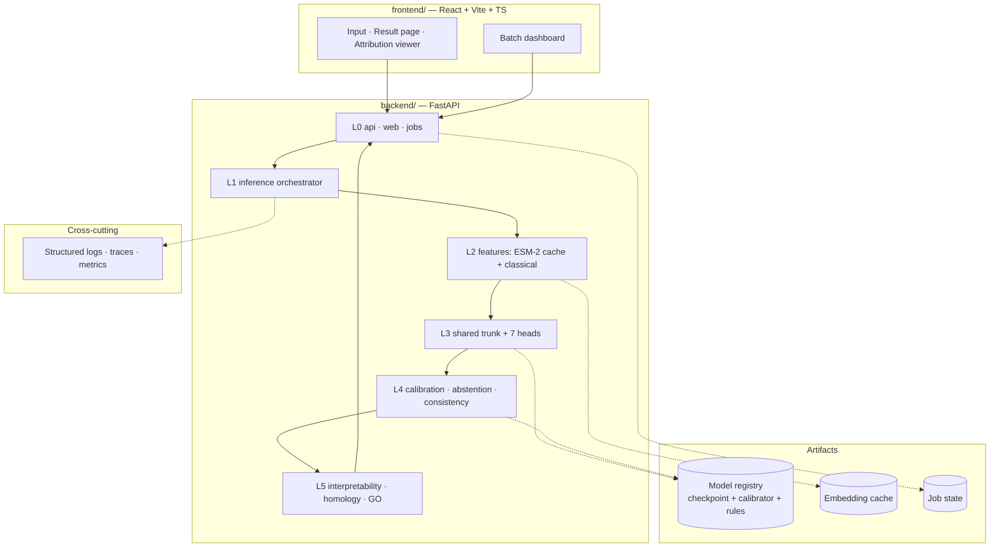

# ProtLoc Fusion — Master Project Plan

> Plan of record, MVP → deployment. Companion to `CLAUDE.md` (the execution contract)
> and `docs/phases/NN.md` (per-phase detail).
>
> **Version 2.0 · 2026-10-02.** Version 1.0 (2026-09-09) planned 17 phases from
> scratch and was abandoned at Phase 3 for lack of calendar time. This version keeps
> the working five-screen app as the base and replaces its motif engine with trained
> models over 20 phases.

---

## 1. Overview

- **What:** A unified protein-analysis web server and API that answers seven related
  annotation questions about one protein sequence from a single shared
  protein-language-model representation, returning calibrated probabilities,
  biological-consistency flags, per-residue explanation and independent evidence.
- **Domain / primary artifact:** ML model training (Module E) fused with a full-stack
  web application (Module D). The model is the contribution; the web server is the
  deliverable.
- **Who:** Saikalyan (solo, AI-assisted execution).
- **Goal:** A public research web server, plus a paper whose methods exactly match the
  served code.
- **Scale target:** Production — publicly reachable, unauthenticated submission, whole-
  proteome batch mode.

**Non-functional targets** — these are the numbers the plan is built against. They are
targets to validate in Phase 13, not measurements:

Revised by **ADR-0001 (Accepted, 2026-09-09)** — the API is asynchronous, so the measure
is **time-to-result**, split into queue wait and compute, not request latency.

| Target | Value | Set in phase |
|---|---|---|
| Time-to-result p95, single sequence, warm cache | ≤ 10 s | 13 |
| Time-to-result p95, single sequence, cold | ≤ 60 s | 13 |
| Queue wait p95 under nominal load | ≤ 30 s | 13 |
| Batch throughput | ≥ 500 sequences/hour/worker | 13 |
| Gallery example response (pre-computed, cached) | ≤ 500 ms | 12 |
| Max sequence length | `[FREEZE in Phase 3]` | 3 |
| Job retention window | `[FREEZE in Phase 16]` | 16 |
| Uptime target | 99% (best-effort research service, stated as such) | 15 |
| Cost ceiling | `[CLIENT-TBD — depends on final hosting]` | 16 |

---

## 2. Architecture at a glance

Training is a **separate lifecycle** from serving. It shares the `models/` and
`features/` code but never runs in the serving container and never imports from
`api/`, `web/` or `jobs/`.

---

## 3. Scope

**In scope (Core).** Seven task heads (localization, membrane type, prokaryotic
localization, signal peptide + cleavage site, mTP, cTP, GO); ESM-2 representation with a
classical feature branch; LoRA adaptation study; per-head calibration and abstention;
YAML biological consistency engine; per-residue attribution; homology + GO evidence;
FastAPI service; React frontend; resumable whole-proteome batch mode; the 24-item
formality layer already scoped (`DESIGN.md`, `ARCHITECTURE.md`, ADRs, provenance).

**Nice-to-have.** Dark mode, logo/identity, module responsibility matrix.

**Explicitly out of scope.** A pip-installable library or CLI; a live public benchmark
page running competitor tools on demand; a demo video; a C4 diagram set; user accounts
and saved history (see §7).

---

## 4. Phase roadmap

Twenty phases. Each leaves the app runnable, each has a binary exit criterion, and each
ends with an **optional** push — the branch work is local, the push is the only step that
leaves the machine. `MVP` is the minimum viable path; `ENH` is droppable without leaving
the app broken.

Commit subjects are conventional-commit with a `(phase-NN)` scope, so
`git log --oneline --grep "phase-07"` reconstructs a phase. Tags are annotated `v0.NN.0`.

| # | Phase | Track | h | Objective | Exit criterion (binary) |
|---|---|---|---|---|---|
| 0 | Cleanup & restructure | — | — | One repo; MVP promoted into it | **COMPLETE 2026-09-28** — `protloc-fusion` is the only tree, the five screens run from it |
| 1 | Repository init & licensing | MVP | 2.0 | git init, CI green, redistribution policy stated before data lands | `ruff`, `pytest` and the pushed `ci.yml` all green; `LICENSE`, `THIRD_PARTY_NOTICES.md`, `docs/DATA_LICENSING.md` present; the app still serves five screens |
| 2 | Host decision | MVP | 3.0 | Replace the invalidated hosting decision with a measured one | ADR-0005 marked superseded; ADR-0007 and ADR-0008 written; a hello-world container answers 200 on a public URL, with the measured cold-start time recorded in the ADR |
| 3 | Widen the contract | MVP | 2.5 | Add provenance, per-label threshold, calibration and abstention fields, additively | Round-trip and backward-compatibility tests pass; regenerated spec and TS diff clean; a no-threshold-cleared sequence shows the no-confident-call state |
| 4 | Motif-engine test harness | MVP | 3.0 | Lock today's behaviour before changing it | A golden set of ≥40 sequences with recorded motif-era outputs; any later engine change shows as an explicit diff, not a silent drift |
| 5 | Swiss-Prot corpus & labels | MVP | 8.0 | Build the immutable labelled dataset — real data, no synthetic | Manifest with release `2026_03`, date and SHA-256; rerunning the build reproduces the identical hash; class counts recorded against the DeepLoc scale (≈25k sequences, 10 localization / 4 membrane / 9 signal classes) |
| 6 | GraphPart splits & leakage gate | MVP | 5.0 | Make generalization measurable | `leakage_report.json` shows 0 cross-partition duplicates and 0 cross-partition homology clusters at 30% identity; 5 partitions; `sequences_removed` recorded |
| 7 | ESM-2 embedding cache | MVP | 6.0 | Produce the shared representation and measure its cost | A known sequence's embedding is byte-identical across two runs; mean-pooled cache size and per-sequence extraction time are recorded numbers, not estimates; ADR-0009 written |
| 8 | Classical baselines | ENH | 3.0 | Establish the metric floor | LogReg / SVM / RF on the motif features, trained on the frozen split, metrics in a table. Fallback if dropped: cite DeepLoc's published numbers as the floor |
| 9 | Localization head | MVP | 7.0 | The first genuinely trained output | Attention-pooling + MLP head trained on the frozen split; Macro F1 and per-compartment MCC on the held-out partition recorded against the DeepLoc targets (Macro F1 ≈ 0.46, Jaccard ≈ 0.53) |
| 10 | Calibration & thresholds | MVP | 5.0 | Make the probabilities mean something | Per-label isotonic fitted on a homology-partitioned calibration split; ECE before and after recorded; per-label MCC-tuned thresholds frozen in the registry, not in code |
| 11 | Signal-peptide CRF head | ENH | 8.0 | Per-residue sorting signal + cleavage site | Frozen per-residue embeddings → CNN/BiLSTM → linear-chain CRF; cleavage accuracy recorded against TargetP's 83% SP / 46–49% transit. Fallback if dropped: keep the motif h-region detector, labelled `source: "motif"` |
| 12 | GO head | ENH | 4.0 | Functional annotation from the same representation | Top-k GO terms with a recorded precision@k. Fallback: keep the PROSITE-style motif hits |
| 13 | Homology evidence | ENH | 5.0 | A second, independent verdict | MMseqs2 index over Swiss-Prot queried off the request path; index size, RAM and p95 query latency measured. Fallback: the existing k-mer search over a real (not synthetic) reference slice |
| 14 | Swap the engine | MVP | 6.0 | Model behind the unchanged API | Every field the trained heads cover returns `source: "model"`; all five screens render unchanged; the synthetic-data banner is replaced by a real model-version banner; `reference_demo.py` deleted |
| 15 | Real attribution | ENH | 4.0 | Explain the model, not the motifs | Per-residue attribution from pooling attention and CRF marginals, not hydropathy. Note: FlashAttention discards the attention matrix, so the explain path must not use it |
| 16 | Frontend upgrade | MVP | 7.0 | The interface a biologist will actually use | Landing page, example gallery, richer result page, downloads (JSON/CSV/FASTA), light **and** dark; every screen renders against the deployed backend; keyboard navigation works on the sequence viewer |
| 17 | Limits, errors, degraded states | ENH | 3.0 | Behave under abuse and partial failure | Oversized input, malformed FASTA, a killed evidence service and a cold cache each produce a correct, legible state rather than a stack trace **Done 2026-10-05 (branch, v0.18.0): stable error codes, strict FASTA with line numbers, degraded evidence flag, cold-cache refusal, ProblemNotice retry only where retryable. A killed evidence service was exercised by code path and unit tests, not by killing a real process.** |
| 18 | Nightingale visual rebuild | ENH | 5.0 | Standard feature tracks | Nightingale tracks replace the hand-rolled `SequenceTrack`; `nightingale-structure` and `molstar` are dynamically imported, never in the main chunk **Nightingale deferred (ADR-0018); the hand-built viewer was polished instead (ruler, swatch legend). The row's Nightingale exit criterion is not met.** |
| 19 | Deploy | MVP | 5.0 | Publicly reachable | Backend and frontend both live on the Phase 2 hosts; weights pulled from the HF model repo at a pinned SHA; a cold-start request succeeds from a device outside the home network |
| 20 | Eval report, docs, release | MVP | 4.0 | The numbers and the paper trail | Every reported metric reproducible by one command against the **served** path; README, OpenAPI page and citation block current; `v1.0.0` tagged and released |

**The Phase 14 rule.** Phase 14 is the spine of this plan. One trained head swapped in
behind the unchanged API beats seven heads that never reach the served path. If the week
compresses, cut heads (11, 12) and visuals (18), never Phase 14 — an app still running the
motif engine at the deadline has no result to report.

**The freeze rule still holds.** Any value the report quotes — split threshold, τ, loss
weights, per-label thresholds — is frozen on the calibration split *before* the held-out
partition is touched. The calibrator must respect the same GraphPart clustering as the
train/test split; fitted without it, the ECE is optimistically low and meaningless.

---

## 5. Production readiness — the five layers

**Observability (Phase 15).** Every request carries a correlation ID from HTTP entry to
evidence return. Spans wrap each pipeline stage — embedding, trunk, each head,
calibration, consistency, evidence — with duration and cache-hit status. Metrics: latency
percentiles, error rate, throughput, cache hit rate, abstention rate, consistency
violation rate. Abstention rate and violation rate are *product* metrics here: a sudden
spike in either means the model is being fed something it was not trained for. The
instrumentation is a thin internal interface, not a vendor SDK sprayed through the code.

**Security & permissions (Phase 15).** This service is unauthenticated and takes
arbitrary user text, so the threat surface is input, not identity. Hard caps on sequence
length and FASTA file size, enforced at the API boundary before parsing. Strict
amino-acid alphabet validation. Rate limits per IP with a queue rather than a rejection
for batch. No shell interpolation anywhere near user input — GraphPart and the external
tools are training-time only and never invoked from the served path. The evidence
service, which makes outbound calls, runs with its own timeout and circuit breaker so a
slow external database cannot exhaust the request pool. Secrets live in `.env` locally
and in the host's secret manager in production; `.env.example` carries placeholders only.

**Evaluation & testing (Phase 14).** Unit tests beside code; integration tests against a
running container; the golden set from Blueprint §23.1 covering secreted, membrane,
cytoplasmic, mitochondrial, chloroplast, Gram+, Gram−, multi-label, ambiguous and
edge-case sequences. The eval suite calls the **served path**, so it measures what users
receive. CI blocks a merge that drops any head's macro-F1 below its recorded baseline.

**Governance & cost (Phase 16).** Cost per prediction is measured in Phase 13 and
budgeted in Phase 16. Batch jobs carry a hard sequence ceiling per submission and a
per-IP concurrent-job limit. Consequential actions are logged. There are no irreversible
or financial actions in this system, which removes an entire class of governance
requirement — say so explicitly rather than inventing controls that do nothing.

**Deployment & rollback (Phase 16–17).** Two Dockerfiles: a CPU serving image and a
GPU training image, deliberately separate. The registry bundle — checkpoint, calibrator,
consistency rules, config — is the atomic unit of deployment, so rollback means pointing
`MODEL_VERSION` at the previous bundle and restarting. That path must be *rehearsed and
timed* in Phase 16, not merely documented.

---

## 6. Risks & failure modes

**The infrastructure conflict — read this first.** The scale target is a public web
server; the infrastructure is Colab/Kaggle for embedding extraction and a free or
near-free tier for serving. These are in tension, and pretending otherwise produces a
plan that fails at Phase 19.

- **Resolved by dropping to ESM-2 150M** (ADR-0009, Phase 7): roughly 600 MB in fp32
  against 650M's ~2.5 GB, which fits a 2 GiB Cloud Run instance or HF CPU Basic's 16 GB
  with room for the heads. The old 650M pick would have timed out or OOMed on every
  free-tier candidate.
- **Docker Spaces stopped being free** around 8–9 July 2026 — PRO is $9/mo and only
  Static Spaces remain free, which invalidated ADR-0005 outright. Phase 2 picks the
  replacement and records the measured cold start.
- **Disk is ephemeral on every candidate.** Weights are re-pulled from the HF model repo
  at a pinned SHA on cold start, and the in-memory job queue loses jobs on restart —
  which is why ADR-0008 scopes batch mode to client-side chunking.
- **Colab and Kaggle sessions terminate.** Embedding extraction checkpoints per shard and
  resumes, or a six-hour run is lost repeatedly. Head training is a minutes-long CPU job
  once the cache exists, so the GPU is only ever needed for extraction.

**RESOLVED — `docs/adr/ADR-0001-serving-strategy.md`, Accepted 2026-09-09: queue
everything.** No synchronous prediction. Every submission becomes a job and the user gets
a result URL; a single sequence is a job of size one. Chosen over a two-tier model
(which would mean two calibration sets and the possibility of a user's interactive and
batch answers disagreeing — reproducing the incoherence this project exists to remove)
and over paid serving (unfunded, and a dead URL in a published paper is worse than a slow
one). One model, one code path, one set of results.

Residual constraint: **Colab/Kaggle session termination.** Every training run must
checkpoint to durable storage each epoch and support `--resume`, or a terminated session
loses the run. This is a Phase 8 requirement, tracked separately from ADR-0001.

**Data leakage (designed out in Phase 4).** Random splits make the test set unrealistically
easy. GraphPart plus independent leakage assertions is the gate; Phase 4 cannot exit while
either assertion fails.

**Train/serve skew (designed out in Phases 5 and 7).** The classic failure is features
computed one way in training and another in serving. Mitigation: a single feature-extraction
code path shared by both, and the Phase 7 rule that evaluation metrics come from the served
path — skew becomes visible as a metric gap rather than hiding until deployment.

**Unversioned artifacts (designed out in Phase 11).** A checkpoint served with a mismatched
calibrator produces confidently wrong probabilities and is nearly undetectable. The registry
bundle binds checkpoint, calibrator and rules atomically; the service refuses to start on a
bundle whose checksums do not verify.

**Silent drift (Phase 17).** UniProt releases move; the model does not. Monitor input length
and composition distributions against the training corpus, plus abstention rate. A rising
abstention rate is the earliest honest signal that inputs have drifted.

**Scope collapse under deadline.** The Core list is 24 formality items on top of a
seven-head model. The Phase 7 vertical slice exists precisely so that, if time runs out,
what exists is one complete honest system rather than seven half-built ones.

---

## 7. Open questions & blocked items

**No phase is blocked.** Every decision that required a human choice has an accepted ADR.
What remains are values produced by running the phase that owns them.

### 7.1 Decisions — all closed

| # | Question | Resolution |
|---|---|---|
| 1 | Serving strategy | **ADR-0001** — queue everything; no synchronous prediction |
| 2 | GraphPart threshold + backend | **ADR-0002** — 30% max global identity, `needleall`, 5 partitions |
| 3 | Evidence layer sources | **ADR-0003** — self-hosted Swiss-Prot MMseqs2 + UniProt-GOA snapshots |
| 4 | Experiment tracking | **ADR-0004** — run manifest authoritative, W&B as viewer |
| 5 | Hosting + artifact storage | **ADR-0005** — HF Spaces (Docker + Static) + HF Hub repos |
| 6 | User accounts / saved history | Out of scope for v1; revisit post-launch |

### 7.2 Freeze schedule — values, not decisions

These are **not blockers.** Each is produced by running its phase; the rule is that it is
frozen before the test set is touched, and recorded where the manifest can find it.

| Value | Frozen in | How it is determined | Recorded in |
|---|---|---|---|
| UniProt release + download date | Phase 3 | The release string on the day you snapshot | dataset manifest |
| `MAX_SEQUENCE_LENGTH` | Phase 3 | Corpus length distribution | dataset card + `.env` |
| `partitioner_version`, `removal_rate` | Phase 4 | GraphPart run output | split manifest |
| `ESM_REVISION` | Phase 5 | HF model page commit hash | run manifest |
| Loss weights λ₁…λ₇ | Phase 8 | Validation sweep | run manifest |
| Abstention threshold τ (per head) | Phase 9 | Validation coverage–risk analysis | registry bundle |
| `GOA_RELEASE` + SHA-256 | Phase 10 | GAF snapshot | dataset manifest |
| `MAX_BATCH_SEQUENCES` | Phase 11 | Measured throughput | `.env` |
| `JOB_RETENTION_HOURS`, rate limits | Phase 16 | Storage + load budget | `.env` |

### 7.3 Open measurements — tracked, non-blocking

| # | Item | Due by | Owner |
|---|---|---|---|
| M1 | Actual RAM, cold-start time and request timeout inside a running HF Space | Phase 17 | ADR-0005 §7 |
| M2 | All `<PIN>` commit SHAs in `docs/THIRD_PARTY.md` | Phase 1 | Resolve at first checkout |
| M3 | Cost per prediction | Phase 16 | Measured, then budgeted |

No value in this section is invented. Where a number is unknown it is scheduled, not
guessed.

---

## 8. Handover protocol

Every phase ends with three artifacts, so a cold session with no chat history can resume:

1. **`docs/phases/NN.md`** — the phase note, self-contained: objective, deliverables with
   paths, the acceptance test and its result, files touched, what was deferred, and the
   first three actions for the next phase. It doubles as the GitHub Release body.
2. **A ticked box in `CLAUDE.md` §Current phase**, with the result recorded beneath.
3. **An ADR in `docs/adr/`** if the phase made a decision that would cost a retrain or a
   re-split to undo.

All dates absolute (`2026-10-02`), never relative (`last week`). Do not begin Phase N+1
until Phase N's exit criterion has been verified and the handover written.
