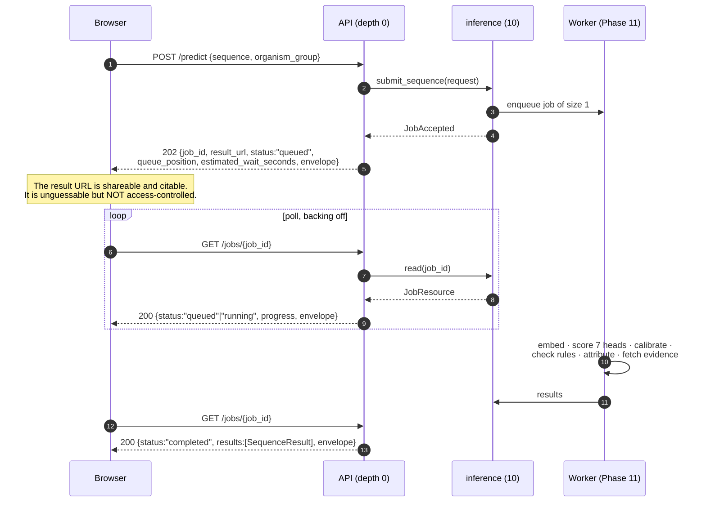
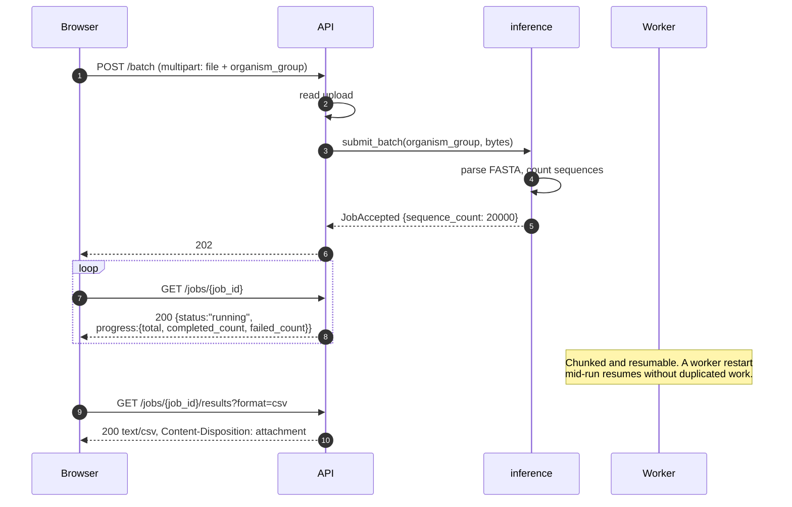
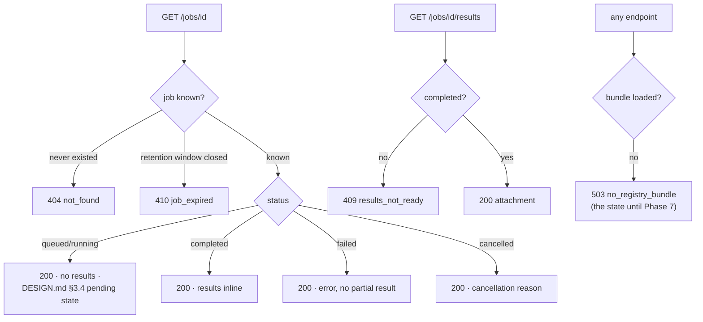
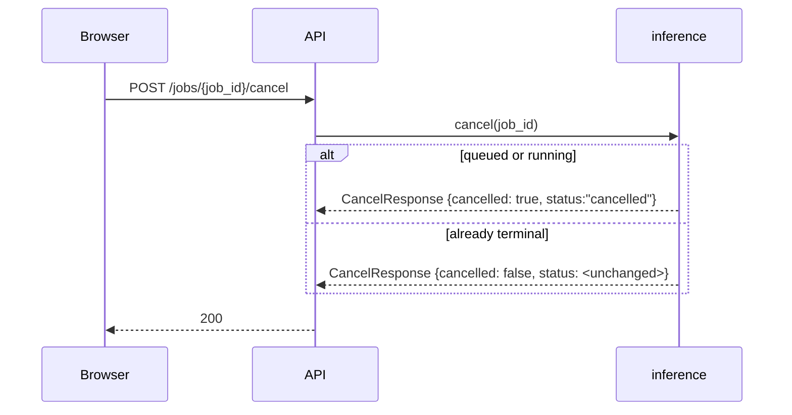

# Request sequence

Every prediction is a job (ADR-0001). This is what that looks like on the wire, including
the branches people forget to design for.

---

## 1. Single sequence — the ordinary path

**Step 5 is the one that surprises people.** `POST /predict` returns no prediction, ever.
The server may answer a size-one job inline with `200` if it finishes inside
`INLINE_RESULT_WINDOW_SECONDS`, but that is a runtime convenience, is absent from the
OpenAPI document, and a client that assumes it is broken against any busy deployment.

**Polling cadence.** The frontend backs off rather than hammering: roughly 1 s for the
first 10 s, then 2 s, then 5 s, capped. `estimated_wait_seconds` informs the first
interval and is displayed with a hedging word — it is an estimate from queue depth and
measured throughput, never a promise.

---

## 2. Batch — a proteome

A member sequence that fails does **not** fail the job: it lands in `failed_count`, and its
`SequenceResult` carries an `error` with no partial prediction attached. A partial
prediction presented as a result is worse than an admitted failure.

`?format=csv` flattens to one row per sequence and task and necessarily omits per-residue
attribution. The document says so, so nobody discovers it by diffing two downloads.

---

## 3. The branches that are easy to skip

**404 and 410 are deliberately different.** A user holding a URL from last month should be
told the result expired, not that it never existed — the second reading invites them to
doubt whether they ever ran the job.

**A failed job still answers 200.** The job resource exists and describes a failure; the
HTTP status describes whether the *resource* could be read. Clients branch on `status`, and
on the stable `error` code in an error body — never on the human-readable message, which
may be reworded without a contract change.

**Every one of these bodies carries the reproducibility envelope**, including the 404. That
is the point of rule 6: a user reporting a failure can say which model version produced it
without being asked to reproduce it first.

---

## 4. Cancellation

Cancelling a terminal job is **not** an error. The caller's intent — that this job not run —
is already satisfied, and answering `409` would make a retry after a dropped connection
look like a bug. `cancelled` says whether this call changed anything.

---

## 5. Degradation

The evidence service is allowed to fail without taking the prediction with it (ADR-0003).
When it does, `Evidence.available` is `false` and `unavailable_reason` says why, rather
than the response carrying two empty lists that read as *"no homologs found"*. Those are
different claims, and only one of them is a scientific statement.

The same principle governs the whole contract: **absent, abstained, masked and pending are
four different things**, and none of them is rendered as another.
